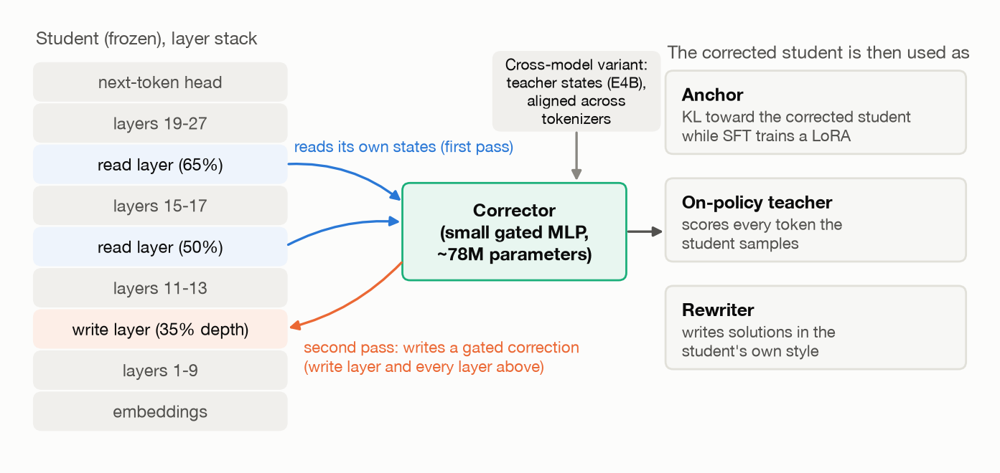
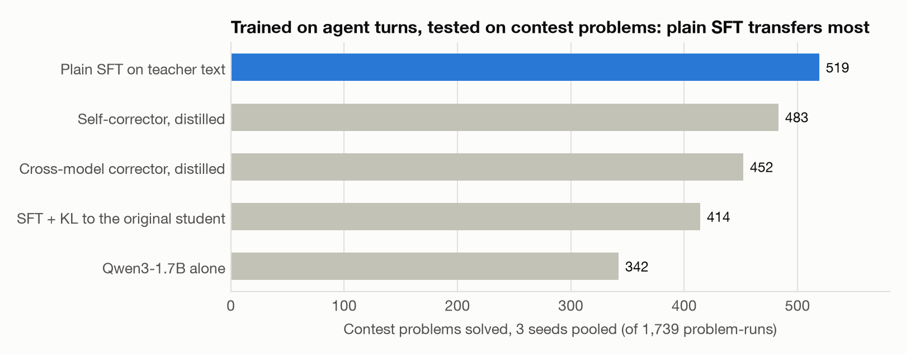
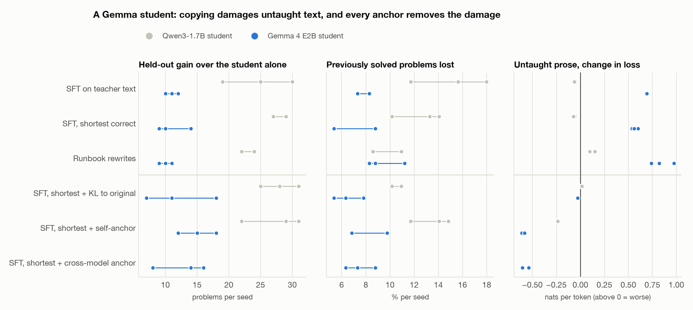
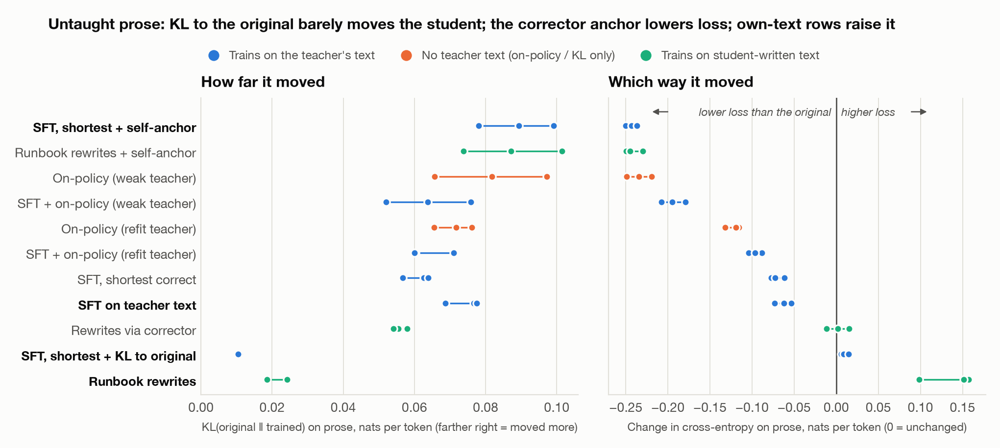
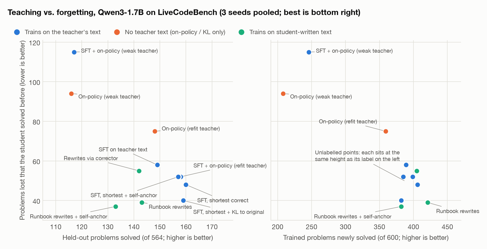
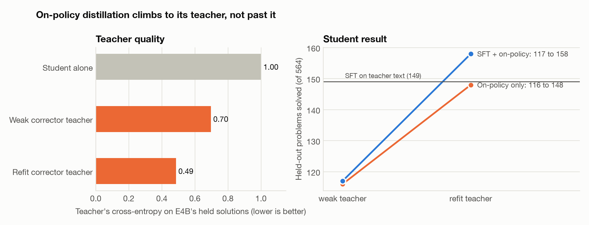
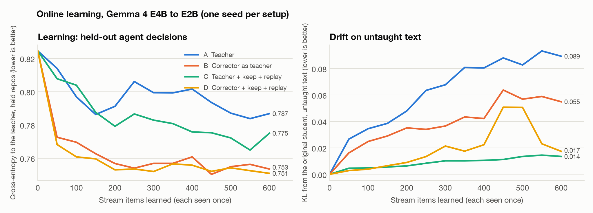

# Copy, Correct, or Rewrite? What Teaches a Small Model and What Keeps It From Forgetting

Benjamin Babeshkin

*Lessons for training Gemma 4 E2B/E4B developer agents from a stronger teacher.*

## Abstract

A small agent model trained by a stronger one must gain the teacher's skill without losing its own. Under one pre-registered protocol, with Gemma 4 E4B teaching Qwen3-1.7B and Gemma 4 E2B on contest coding and E2B on online agent decisions, we compare copying verified answers (SFT), anchoring, on-policy distillation and retraining on self-written solutions. Copying taught as much as anything, best with the shortest answers. Within the Gemma family it also forgot: E4B's text is familiar to E2B, and training on it sharpened the student and raised its loss on untaught text. A KL pull toward the original student removed that damage without costing held-out solves. Self-written solutions also sharpened, and on-policy distillation stopped at its teacher's level. A learned state corrector did not store the teacher's knowledge in an adapter; as an anchor it matched training on its own fitting text, and as an online teacher it gave the best net result, reproduced in a second seed.

## 1 Introduction

Submissions to the Gemma 4 Developer Agent competition (Kaggle, 2026) are Gemma 4 E2B or E4B (Google, 2026) plus LoRA adapters (Hu et al., 2021) of rank at most 128, so any gain from a stronger teacher must survive being stored in an adapter. Distillation (Hinton et al., 2015) is the main lever, but every route risks erasing what the small model already does well, such as reading, instruction following and decision making. We ask which route teaches the most and forgets the least.

To test whether a teacher's internal states can be stored, we built a *state corrector*, inspired by Swarm Telepathy (Alabdulkareem et al., 2026), which moves one model's KV cache into a frozen receiver of another family. Ours reads hidden states and writes a correction into the student's residual stream; it also served as an anchor and online teacher. Our contributions:

- Copying verified answers teaches as much as any route, best with the shortest.
- Same-family copying forgets: E2B lost far more on untaught text than Qwen.
- A KL pull toward the original student removes that damage at no cost.
- Self-written solutions move the student least yet sharpen it.
- On-policy distillation reaches its teacher's level and stops there.
- Teacher states do not store: the corrector fed E4B's states taught no better than fed the student's own.
- Code, results, 40,000+ graded answers and the pre-registration log (Appendix A).

## 2 Background

A teacher row is a prompt x and a verified reply y. SFT minimizes the cross-entropy of y; an anchored recipe adds a pull toward a reference distribution q over the reply:

L = CE(y | x) + λ · KL(q ‖ p_θ), with λ = 1.  (1)

With q the untrained student, eq. (1) is learning without forgetting (Li and Hoiem, 2016); with q the corrected student, it is the *corrector anchor*. On-policy distillation (Agarwal et al., 2023) samples ŷ from the student and minimizes the reverse KL to a teacher t on those tokens:

L = Σ_i KL(p_θ ‖ t) over the positions i of ŷ.  (2)

## 3 Method

Figure 1. How the corrector connects teacher and student, and how its output trains the student.

**Structure.** A gated MLP (78M parameters for Qwen, 83M cross-model) reads the student's hidden states at 50% and 65% depth in a first pass. In a second pass it writes a gated, additive correction at 35% depth and every layer above. The *self-corrector* reads the student's own states; the *cross-model corrector* reads E4B's, aligned token by token across tokenizers.

**Fit.** We fit it for 600 steps at lr 3e-4 on

L_fit = CE_corrected + 0.03 · ‖Δ‖ + 0.5 · H,  (3)

with ‖Δ‖ the size of the change and H a do-no-harm term that keeps the student's own top-32 distribution wherever it already ranks the true token first. Rows: E4B's agent replies (50%), human prose (15%), Python code (15%), multiple-choice questions (10%) and stories (10%).

**Use.** Run live, the corrected student is far closer to the teacher on agent replies than the student alone (0.67 nats against 1.39; self-corrector 0.73). We test it as an anchor (eq. 1), an on-policy teacher (eq. 2), a rewriter, a distilled LoRA and an online teacher.

## 4 Experiments

### 4.1 Setup

**Models.** The teacher is Gemma 4 E4B (4-bit QAT, dequantised to bf16). The coding students are Qwen3-1.7B (Yang et al., 2025), whose different tokenizer tests transfer across vocabularies, and Gemma 4 E2B.

**Training data.** 299 older LiveCodeBench problems (Jain et al., 2024; May 2023 to Sep 2024), each with E4B's own solution passing every hidden test.

**Optimization.** A rank-64 LoRA (alpha 128) on the MLPs of layers 9-27, lr 3e-4 with warm-up and cosine decay, 299 steps of two rows, the same rows and order for every recipe.

**Evaluation.** Greedy answers with a 768-token cap. *Fixed*: of the 200 training problems the untrained student fails, how many it now solves. *New*: the same for the 163 of 188 newer held-out problems (Sep 2024 to Apr 2025, easy and medium) it fails. *Held solved*: all 188. *Lost*: previously solved problems (25 held-out, 103 in the training pool) now failed. *Drift*: KL(original ‖ trained) and the change in cross-entropy on held-out human prose, Python code and stories, every seventh text of the corrector's sources, never trained on. *Fresh-question p(true)*: mean probability of the true answer on held-out multiple-choice questions. Counts are pooled over three seeds with exact sign tests on discordant problems; every comparison was pre-registered (Appendix C). Re-evaluation reproduced per-problem results exactly (0 of 495 differed), so arms pair across sessions; retraining is not exact (two plain-SFT runs differed by 6 held solves).

### 4.2 Copying the teacher's verified text teaches the most

Figure 2. LoRAs trained on E4B's agent turns, on LiveCodeBench (1,739 problem-runs): problems gained and lost against the untrained student.

Every trained form beats the untrained student (p < 1e-6), and plain SFT leads the corrector's distilled self and cross-model forms (161 vs 125 problems solved by one form only, p = 0.04; 181 vs 114, p = 0.0001) while losing fewer solved problems (76, against 82-89). E4B's states added nothing a stored adapter kept (cross-model vs self, 113 vs 144); their live advantage was only 0.05-0.06 nats on agent replies. SFT with a KL pull toward the original lost the fewest (66) but gained the least (vs SFT 90 vs 195, p = 5e-10); on coding rows it did well (Section 4.5).

In a separate coding run the anchors did not lose to SFT (held solved: SFT 143, anchors 146-152), and SDFT, in-context self-distillation (Shenfeld et al., 2026), lost clearly (111 held solved, 148 lost; vs SFT 25 vs 57, p = 0.0005). The shortest passing solutions (median 295 tokens, not 355) raised held solved from 149 to 160 and cut losses from 58 to 48 (clear in one seed).

### 4.3 Copying within the family forgets, and an anchor fixes it

E2B replaced Qwen, all else equal; it starts stronger (57 held problems solved alone, against 25) and finds E4B's solutions nearly its own (0.27 nats per token, against 1.05). Gains were smaller, about 11 held problems per seed against 19-30 for Qwen. Runbook rows lost their advantage (fixed 61 vs 111 for SFT, p = 0.0002): E2B's rewrites were no closer to it than E4B's text (0.38 vs 0.27 nats). Every copying recipe damaged untaught text (Table 1, Figure 3): 4-13× Qwen's KL, sharper predictions (entropy −0.3 to −0.8) and higher loss on prose, code and stories, though a smaller share of solved coding problems was lost.

Table 1. Gemma 4 E2B as the student, per-seed means over three seeds (alone: 57 held solved).

| Recipe | Held solved | Fixed (of 151) | Lost (of 205) | Prose KL | Prose Δ loss |
|---|---|---|---|---|---|
| SFT | 68.0 | 119.7 | 15.7 | 0.29 | +0.69 |
| Shortest rows | 68.0 | 123.0 | 15.7 | 0.29 | +0.57 |
| Runbook rows | 67.0 | 106.0 | 19.3 | 0.29 | +0.85 |
| Shortest + KL to the original | 69.0 | 90.7 | **13.3** | **0.016** | −0.04 |
| Shortest + self-corrector anchor | **72.0** | 95.3 | 16.0 | 0.33 | −0.60 |
| Shortest + cross-model anchor | 69.7 | 99.3 | 15.3 | 0.32 | −0.58 |
| Shortest + the corrector's fitting text | 71.3 | 105.0 | 16.3 | 0.83 | −0.75 |
| Shortest + fitting text + KL to the original | 68.7 | 83.3 | 17.3 | 0.81 | −0.76 |

The likely cause is over-fitting familiar text. E2B's training loss on E4B's rows started low (0.28 nats), barely fell in the first epoch and reached 0.07 in the second. Qwen went from 0.62 to 0.24 and softened; its one sharpening recipe, runbook rows, also started familiar (0.25 to 0.03). Yet E2B moved about 13× more than that arm at a similar final loss, so part of the effect is the student; a matched-loss run was still running.

Every anchor removed the damage in every seed and held E2B's training loss at 0.11-0.12, not 0.08. KL to the original kept E2B in place (prose KL 0.016, Δ loss −0.04) without costing held solves (207 vs 204). Anchors to fresh Gemma correctors moved it as far as SFT, toward lower loss and softer predictions (Δ loss −0.58 to −0.60); held solves rose by at most 12 (216 vs 204, p = 0.22), at about 25 fewer fixes per seed. Training directly on the corrector's fitting text matched that anchor (held 214 vs 216, p = 0.90; prose Δ loss −0.75) and came closer on agent replies (0.50 vs 0.65), but moved E2B much further (prose KL 0.83 vs 0.33): the anchor's gain is its fitting text, delivered with less change. The KL pull did not reduce that (0.81): it covers only the coding replies. Each Gemma corrector cut loss on its own fitting mix by 27-29% (Qwen's 34-37%) but left E2B's loss on E4B's coding rows unchanged.

Figure 3. Qwen3-1.7B (gray) and Gemma 4 E2B (colour) per recipe, grouped by kind.

### 4.4 Reversed: E2B teaching E4B

With E2B's 148 passing answers teaching E4B (weak-to-strong; Burns et al., 2023), SFT barely helped (224 held solved against 207 alone) and damaged E4B's prose most of all (+0.81). Every anchor did significantly better (244-250; self-corrector vs SFT 52 vs 26, p = 0.004), lost fewer and removed the damage. Cross-model and self anchors tied both ways (209 vs 216; 249 vs 250).

### 4.5 What keeps the student where it was

On Qwen's shortest rows (Table 2, Figure 4), KL to the original moved the student 6-9× less than the other copying recipes and left prose loss unchanged. The corrector anchor moved it as far as SFT, toward much lower loss and softer predictions (entropy +0.66 nats on prose, against +0.29 for SFT). It never sees prose; the gain comes from the corrector's prose fit.

Table 2. Drift from the original Qwen on untaught text, three-seed means.

| Recipe | KL from the original (prose) | Change in loss (nats): prose / code / stories |
|---|---|---|
| Plain SFT | 0.074 | −0.06 / −0.08 / −0.10 |
| Shortest + KL to the original | **0.010** | +0.01 / −0.10 / −0.02 |
| Shortest + corrector anchor | 0.089 | −0.24 / −0.21 / −0.51 |

Figure 4. Drift on untaught human prose, one point per seed.

Neither anchor costs teaching (Table 3); the corrector anchor's value shows where training does real damage (Sections 4.3 and 4.6).

Table 3. Coding with the two anchors, three seeds pooled (held of 564).

| Recipe | Held solved | Lost (of 384) | Fresh-question p(true) |
|---|---|---|---|
| Shortest rows | 160 | 48 | 0.527 |
| Shortest + KL to the original | 159 | **40** | 0.521 |
| Shortest + corrector anchor | 157 | 52 | 0.554 |
| Plain SFT | 149 | 58 | 0.557 |
| Untrained student | — | — | 0.513 |

### 4.6 The student's own words sharpen it

Adapting the self-rewrite step of Terminal-RSI (Yang et al., 2026), E4B turns each verified solution into a numbered plain-English plan (a screen rejects plans with code or over 10% of the solution's code 4-grams), the student solves the problem with the plan in its prompt, and passing solutions are trained on without the plan. With a plan it solved 166 problems greedily (95 without). The 228 rows kept are the student's own text: similarity to E4B's solution 0.20, 0.32 nats under the untrained student (E4B's rows 1.05), 110 tokens (350).

Table 4. Runbook rows, three seeds pooled; prose ΔCE per seed.

| Recipe | Fixed | New | Held solved | Lost (of 384) | Prose ΔCE (per seed) |
|---|---|---|---|---|---|
| Plain SFT | 389 | 90 | 149 | 58 | −0.05 to −0.07 |
| Runbook rows | **421** | 83 | 143 | 39 | **+0.10 to +0.16** |
| Runbook rows + self-anchor | 382 | 71 | 133 | 37 | −0.23 to −0.25 |

Runbook rows generalised less (83 new, against 90-95) but fixed the most training problems (vs SFT 133 vs 84, in every seed) and lost the fewest training-pool problems (24; others 29-43). They are the only Qwen recipe that raised loss on untaught text, in every seed and kind, while barely moving the student (KL 0.022), and lowered its entropy the most (−0.23 nats on prose): training on its own confident text sharpens the student. A small KL is no proof against forgetting (compare Shenfeld et al., 2025). The corrector anchor reversed that in every seed, to lower loss than the original (−0.23 to −0.25 on prose; entropy +0.64), and raised fresh-question p(true) by 0.028, at the cost of 39 fewer fixed problems (29 vs 71, p = 3e-5) and fewer held solves (133 vs 143).

Figure 5. Every coding recipe, three seeds, numbered by held-out rank; best is bottom right. The leaders are within noise.

### 4.7 On-policy distillation stops at its teacher

On-policy distillation through the self-corrector reached 116 held solves, its teacher's own live level (117; that teacher put 0.70 nats per token on E4B's solutions, the student alone 1.00). Refit on the 299 solutions (0.49 nats), the teacher solves 151 live and the student 148 (Table 5, Figure 6), beating the weak-teacher version in every seed but only tying SFT (38 vs 39) and losing more training problems (59 vs 42).

Table 5. Held solved, three seeds pooled.

| Recipe | Weak teacher | Refit teacher |
|---|---|---|
| On-policy only | 116 | 148 |
| SFT + on-policy | 117 | 158 |

Figure 6. Each corrector teacher run live, and the on-policy student it trained.

### 4.8 Online learning on agent decisions

E2B with a rank-16 LoRA met 600 unseen agent decision points from the competition's harness, each once, scored before learning it. The target was the teacher's distribution (A) or the cross-model corrector (B), each also with keep + replay (C, D: KL to the original E2B on one untaught row per item, and an earlier item every fourth step). The corrector was fitted on the training repositories, which the stream draws from; the held measures and gate use repositories neither saw. The result is a plain LoRA; the corrector is needed only during training.

Table 6. Online learning, one seed per setup (D: two). Gate (220 held decisions): fixed of the 52 where E2B alone differs from the teacher, broken of the other 168.

| Setup | Held CE (from 0.825) | Untaught drift | Held-question drift | Gate: fixed / broken |
|---|---|---|---|---|
| A Teacher | 0.787 | 0.089 | 0.030 | 25 / 11 |
| B Corrector | 0.753 | 0.055 | 0.043 | 16 / 4 |
| C Teacher + keep + replay | 0.775 | **0.014** | 0.034 | 14 / 6 |
| D Corrector + keep + replay | **0.751** | 0.017 | 0.041 | 23 / **4** |
| D, seed 2 | 0.749 | 0.017 | 0.021 | 23 / 6 |

Keep + replay hurt the plain teacher (A to C: 11 fewer fixed) but helped the corrector teacher (B to D: 7 more). D had the best net gate result (+19, against +14 for A) and beat C on paired decisions (17 vs 6, p = 0.035); its untaught drift peaked at 0.05 near item 450, then fell. D's second seed reproduced it: the two differ on 6 of 220 decisions. Seed 3 of D and seeds 2-3 of C were still running, with a self-corrector teacher and a blend matched to the corrector's pull, akin to a teacher assistant (Mirzadeh et al., 2019).

Figure 7. Held cross-entropy to the teacher and drift on untaught text over the stream.

## 5 Discussion

**For training small agents.** Train on the teacher's shortest verified answers with a KL pull toward the original student, which within the family removed copying's damage at no cost; check the teacher's fit before on-policy distillation; and measure forgetting on held-out human text, with entropy, since loss on teacher text rewards imitation.

**Where the corrector helps.** As an anchor it delivers its fitting text with less change; as an online teacher with keep + replay it gave the best net result in both its seeds; live, it brought the student closest to the teacher. Eight held problems neither E4B nor the untrained student solved were solved in all three seeds; for six, E4B's answer hit the cap, and two look genuine. This points to two-way composition of a generalist and a specialist, extending CALM (Bansal et al., 2024).

**Limitations.** Two coding students and one teacher; the online test has one seed per setup (D two). Pooled p-values are descriptive; differences under about 10 held solves are within noise. The KL pull ran at λ = 1 and the multi-task control only for E2B; a strength sweep was still running. A 768-token cap cannot separate forgetting from verbosity (lost answers ran long, 27% cut at the cap); a longer-cap re-grade was still running.

**Ethical considerations.** Fitting and drift prose and stories come from locally held books, not released. Model-written code ran only in resource-limited, sandboxed interpreters.

## 6 Related Work

**Distillation.** GKD (Agarwal et al., 2023), MiniLLM (Gu et al., 2023) and DistiLLM (Ko et al., 2024) distil on the student's own samples with reverse or skewed KL; our on-policy teacher is built from the corrector, whose fit bounds the gain.

**Training on own solutions.** ReST (Gulcehre et al., 2023), ReST-EM (Singh et al., 2023), rejection-sampling fine-tuning (Yuan et al., 2023) and STaR (Zelikman et al., 2022) retrain on verified own samples; Terminal-RSI (Yang et al., 2026) adds plan-guided self-rewriting. The damage to untaught text we report is rarely measured; it resembles the entropy collapse of reinforcement learning on reasoning (Cui et al., 2025).

**Forgetting.** Learning without forgetting (Li and Hoiem, 2016) and EWC (Kirkpatrick et al., 2016) protect old skills with output and weight penalties, and LoRA learns less and forgets less (Biderman et al., 2024); RL's Razor (Shenfeld et al., 2025) ties forgetting to KL from the original. Self-distillation fine-tuning (Yang et al., 2024) rewrites targets in the model's own words; in-context self-distillation (Shenfeld et al., 2026) is our SDFT arm.

**Cross-model transfer.** Logit-space methods align vocabularies (Boizard et al., 2024; Zhang et al., 2024), model fusion merges distributions (Wan et al., 2024), and model stitching joins representations (Lenc and Vedaldi, 2014; Bansal et al., 2021). The corrector descends from Swarm Telepathy (Alabdulkareem et al., 2026).

## 7 Conclusion

Copying verified answers teaches best; within the family it also forgets, and a KL pull toward the original student is the cheapest fix.

## References

R. Agarwal, N. Vieillard, Y. Zhou, P. Stanczyk, S. Ramos, et al. (2023). On-Policy Distillation of Language Models: Learning from Self-Generated Mistakes. arXiv:2306.13649. https://arxiv.org/abs/2306.13649

A. Alabdulkareem, I. Tenison, Y. Zhang, Y. Zhu, B. Katz, and D. Gutfreund (2026). Swarm Telepathy: Prefill-Free KV-Cache Transfer Across Families. arXiv:2610.15095. https://arxiv.org/abs/2610.15095

Y. Bansal, P. Nakkiran, and B. Barak (2021). Revisiting Model Stitching to Compare Neural Representations. arXiv:2106.07682. https://arxiv.org/abs/2106.07682

R. Bansal, B. Samanta, S. Dalmia, N. Gupta, S. Vashishth, et al. (2024). LLM Augmented LLMs: Expanding Capabilities through Composition. arXiv:2401.02412. https://arxiv.org/abs/2401.02412

N. Boizard, K. El Haddad, C. Hudelot, and P. Colombo (2024). Towards Cross-Tokenizer Distillation: the Universal Logit Distillation Loss for LLMs. arXiv:2402.12030. https://arxiv.org/abs/2402.12030

D. Biderman, J. Portes, J. J. Gonzalez Ortiz, M. Paul, P. Greengard, et al. (2024). LoRA Learns Less and Forgets Less. arXiv:2405.09673. https://arxiv.org/abs/2405.09673

C. Burns, P. Izmailov, J. H. Kirchner, B. Baker, L. Gao, et al. (2023). Weak-to-Strong Generalization: Eliciting Strong Capabilities With Weak Supervision. arXiv:2312.09390. https://arxiv.org/abs/2312.09390

G. Cui, Y. Zhang, J. Chen, L. Yuan, Z. Wang, et al. (2025). The Entropy Mechanism of Reinforcement Learning for Reasoning Language Models. arXiv:2505.22617. https://arxiv.org/abs/2505.22617

Google (2026). Gemma 4 E2B and E4B, instruction-tuned QAT checkpoints (w4a16). Hugging Face model cards google/gemma-4-E2B-it-qat-w4a16-ct (revision 971342c) and google/gemma-4-E4B-it-qat-w4a16-ct (revision 6cd26aa).

Y. Gu, L. Dong, F. Wei, and M. Huang (2023). MiniLLM: On-Policy Distillation of Large Language Models. arXiv:2306.08543. https://arxiv.org/abs/2306.08543

C. Gulcehre, T. L. Paine, S. Srinivasan, K. Konyushkova, L. Weerts, et al. (2023). Reinforced Self-Training (ReST) for Language Modeling. arXiv:2308.08998. https://arxiv.org/abs/2308.08998

G. Hinton, O. Vinyals, and J. Dean (2015). Distilling the Knowledge in a Neural Network. arXiv:1503.02531. https://arxiv.org/abs/1503.02531

E. J. Hu, Y. Shen, P. Wallis, Z. Allen-Zhu, Y. Li, et al. (2021). LoRA: Low-Rank Adaptation of Large Language Models. arXiv:2106.09685. https://arxiv.org/abs/2106.09685

N. Jain, K. Han, A. Gu, W.-D. Li, F. Yan, et al. (2024). LiveCodeBench: Holistic and Contamination Free Evaluation of Large Language Models for Code. arXiv:2403.07974. https://arxiv.org/abs/2403.07974

Kaggle (2026). Gemma 4 Developer Agent competition. https://www.kaggle.com/competitions/gemma-4-developer-agent

J. Kirkpatrick, R. Pascanu, N. Rabinowitz, J. Veness, G. Desjardins, et al. (2016). Overcoming catastrophic forgetting in neural networks. arXiv:1612.00796. https://arxiv.org/abs/1612.00796

J. Ko, S. Kim, T. Chen, and S.-Y. Yun (2024). DistiLLM: Towards Streamlined Distillation for Large Language Models. arXiv:2402.03898. https://arxiv.org/abs/2402.03898

K. Lenc and A. Vedaldi (2014). Understanding image representations by measuring their equivariance and equivalence. arXiv:1411.5908. https://arxiv.org/abs/1411.5908

Z. Li and D. Hoiem (2016). Learning without Forgetting. arXiv:1606.09282. https://arxiv.org/abs/1606.09282

S.-I. Mirzadeh, M. Farajtabar, A. Li, N. Levine, A. Matsukawa, and H. Ghasemzadeh (2019). Improved Knowledge Distillation via Teacher Assistant. arXiv:1902.03393. https://arxiv.org/abs/1902.03393

I. Shenfeld, J. Pari, and P. Agrawal (2025). RL's Razor: Why Online Reinforcement Learning Forgets Less. arXiv:2509.04259. https://arxiv.org/abs/2509.04259

I. Shenfeld, M. Damani, J. Hübotter, and P. Agrawal (2026). Self-Distillation Enables Continual Learning. arXiv:2601.19897. https://arxiv.org/abs/2601.19897

A. Singh, J. D. Co-Reyes, R. Agarwal, A. Anand, P. Patil, et al. (2023). Beyond Human Data: Scaling Self-Training for Problem-Solving with Language Models. arXiv:2312.06585. https://arxiv.org/abs/2312.06585

F. Wan, X. Huang, D. Cai, X. Quan, W. Bi, and S. Shi (2024). Knowledge Fusion of Large Language Models. arXiv:2401.10491. https://arxiv.org/abs/2401.10491

Z. Yang, T. Pang, H. Feng, H. Wang, W. Chen, et al. (2024). Self-Distillation Bridges Distribution Gap in Language Model Fine-Tuning. arXiv:2402.13669. https://arxiv.org/abs/2402.13669

A. Yang, A. Li, B. Yang, B. Zhang, B. Hui, et al. (2025). Qwen3 Technical Report. arXiv:2505.09388. https://arxiv.org/abs/2505.09388

J. Yang, Z. Li, Y. Shi, Z. Li, R. Wang, et al. (2026). Terminal-RSI: Recursive Self-Improving Terminal Agents via Recursive Self-Rewrite and Policy-Refine. arXiv:2610.22192. https://arxiv.org/abs/2610.22192

Z. Yuan, H. Yuan, C. Li, G. Dong, K. Lu, et al. (2023). Scaling Relationship on Learning Mathematical Reasoning with Large Language Models. arXiv:2308.01825. https://arxiv.org/abs/2308.01825

E. Zelikman, Y. Wu, J. Mu, and N. D. Goodman (2022). STaR: Bootstrapping Reasoning With Reasoning. arXiv:2203.14465. https://arxiv.org/abs/2203.14465

S. Zhang, X. Zhang, Z. Sun, Y. Chen, and J. Xu (2024). Dual-Space Knowledge Distillation for Large Language Models. arXiv:2406.17328. https://arxiv.org/abs/2406.17328

## Appendix A Code

Code, per-problem results, over 40,000 graded model answers and the pre-registration log (addenda 165-193) are public at https://github.com/syn-ack-ai/copy-correct-rewrite (Apache-2.0); the corrector is `code/transfer/xbridge.py`. Not included: text corpora, competition data, problem statements and weights.

## Appendix B AI use

The author carried out this study with Claude Opus 5.5 (Anthropic) as an AI research assistant. The author set the research direction, chose the questions and approved each pre-registered experiment; Claude Opus 5.5 designed and ran the experiments, wrote the code and drafted the text. Separate Claude instances reviewed new code and drafts, and verified the numbers.

## Appendix C Pre-registration scorecard

Table 7. Predictions that held, per pre-registered addendum.

| Addendum (question) | Predictions held | Pre-set bar |
|---|---|---|
| 169d (corrector forms vs dose-matched SFT, agent replies) | 0 of 4 | failed |
| 170 (online learning) | 3 of 5 | — |
| 174 (SFT with anchors, SDFT) | 3 of 5 | not met; states added nothing on held |
| 178 (wide coding) | 0 of 1 (reversed) | — |
| 179 (on-policy, shortest rows) | 2 of 3 | — |
| 181 (refit teacher, rewrites) | 9 of 12 | not met |
| 182 (runbook rows) | 8 of 11 | missed by one |
| 184c (runbook rows + self-anchor) | 4 of 6 | not met |
| 185 (SFT + KL to the original) | 5 of 6 | — |
| 186 (Gemma 4 E2B as the coding student) | 5 of 7 | — |
| 187 (two-way, fresh Gemma correctors) | 5 of 7 | not met; cross-model = self |
| 188 (matched-loss run, E2B) | — | running |
| 189 (online setup D: replication, controls) | 3 of 3 so far (seed 2) | running |
| 190 (multi-task control for the corrector anchor) | 4 of 5 | met: the anchor's gain is its fitting text |
| 193 (KL strength sweep) | — | running |
