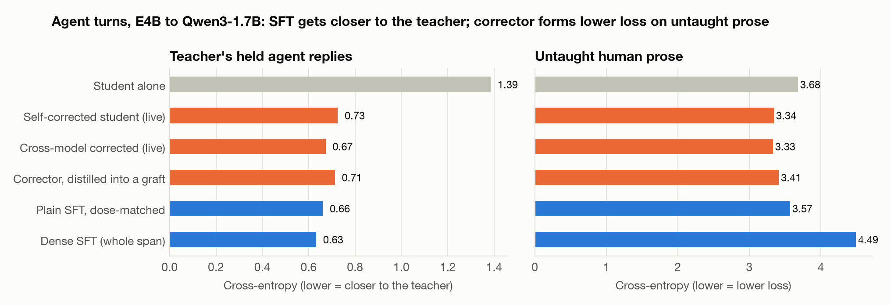
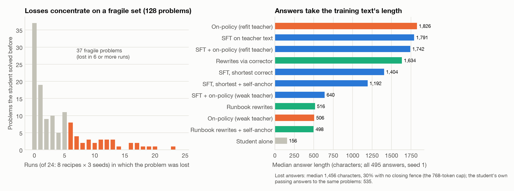

# Copy, Correct, or Rewrite? What Teaches a Small Model and What Keeps It From Forgetting

*Lessons for training Gemma 4 E2B/E4B developer agents from a stronger teacher: copying verified text teaches best, a learned state corrector lowers loss on general text but does not teach more, and on-policy signals stop at their teacher.*

## Abstract

A small model can learn from a stronger one in several ways:
- **copy** the stronger model's verified answers (supervised fine-tuning, SFT);
- **be pulled toward a corrected version of itself**, an *anchor*;
- **be scored token by token on its own samples** (on-policy distillation);
- **retrain on solutions it writes itself** from the stronger model's plan.

These routes were compared under one pre-registered protocol. Teacher: Gemma 4 E4B. Students: Qwen3-1.7B on contest coding (three seeds) and Gemma 4 E2B on online agent decisions (one seed).

Four findings:
- **Copying the teacher's verified answers taught as much as anything tested,** and more than any route through the corrector.
- **The corrector did not teach more than SFT.** The corrector is a learned network that rewrites the student's hidden states. Used as an anchor, it moved the student about as far as SFT, but toward lower loss on untaught text, and it reversed real damage. It did not protect solved coding problems better than simply training on the shortest correct answers.
- **On-policy distillation reached its teacher's level and stopped there.**
- **Student-written solutions fixed the most trained problems, and degraded untaught text in every seed.**

## 1. Question and setup

The competition's $10,000 Small Model Development bonus rewards the best submission built on Gemma 4 E2B or E4B. A submission is a base model, an agent config, and LoRA adapters (rank ≤ 128). Distillation from a stronger model is the main lever, but every distillation route risks erasing what the small model already does well. This study asks **which route teaches the most and forgets the least**.

**Coding testbed.**
- **Teacher and student.** The teacher is Gemma 4 E4B: the 4-bit QAT checkpoint, dequantised to bf16. The student is Qwen3-1.7B. A student with a different tokenizer was chosen on purpose: it tests whether the corrector carries knowledge across vocabularies, which logit distillation cannot do directly.
- **Training rows.** 299 older LiveCodeBench problems (May 2023 to Sep 2024), each paired with E4B's own solution that passes every hidden test. All rows are model-written.
- **Training, identical for every recipe.**
  - A rank-64 LoRA (alpha 128) on the MLP projections of layers 9-27.
  - lr 3e-4 with warm-up and cosine decay.
  - 299 steps of two rows each (two epochs).
  - The same rows in the same order.
  - Cross-entropy on the reply tokens.
  - Anchored recipes add 1.0 × KL(corrected student ‖ student) over the written span.

**Measures.** Per seed, counted on single greedy answers with a 768-token cap:
- **Fixed:** training problems the untrained student fails (200) that the trained one solves.
- **New:** held-out problems it fails (163 of the 188 newer problems, Sep 2024 to Apr 2025, easy and medium) that it now solves.
- **Held solved:** all 188 held-out problems.
- **Lost:** problems it solved before (25 held-out, 103 in the training pool) that it now fails.
- **Drift:** KL(original ‖ trained) and the change in cross-entropy on held-out human prose, Python code and stories that no recipe or corrector trained on. This measures how far, and in which direction, training moved the student off-task.

**Protocol.**
- Three seeds.
- Exact sign tests on discordant problems, pooled over seeds. This treats seeds as independent, so Table 1 gives per-seed values.
- Every comparison and its predictions were written down before it ran (scorecard in Section 6).
- Re-evaluating a stored adapter in a new session reproduced its per-problem results exactly (0 of 495 differed), so arms from different sessions are paired through their stored results.
- Retraining is not exact: two independent runs of plain SFT differed by 6 held solves.

## 2. The state corrector

*Figure 1.* The device, called a *translator* during development, is named here for what it does: it **corrects the student's states**.

**Structure.**
- A gated MLP of 78M parameters, about 5% of the student; 83M for the cross-model variant.
- It reads the student's hidden states at 50% and 65% depth from a first pass.
- In a second pass it writes a gated, additive correction at 35% depth and at every layer above.

**Two variants.**
- The **self-corrector** reads the student's own states.
- The **cross-model corrector** reads E4B's states, aligned token by token across the two tokenizers.

**Fit.**
- **Loss:** cross-entropy of the corrected student on the target text, plus 0.03 × the size of the change, plus 0.5 × a do-no-harm term. That term keeps the student's own top-32 distribution wherever the student already ranks the true token first.
- **Rows:** E4B's agent replies (50%), human prose (15%), Python code (15%), multiple-choice questions (10%) and stories (10%).
- **Schedule:** 600 steps at lr 3e-4.

**Live use.** Run live, with both models at inference, the corrected student is far closer to the teacher on agent replies than the student alone: 0.67 nats against 1.39 (Figure 3). The self-corrector, which never sees E4B, already reaches 0.73. Kaggle accepts only adapters, so only *stored* forms matter.

**Four stored forms.**
- an anchor during SFT;
- an on-policy teacher;
- a rewriter;
- a LoRA distilled from it with no teacher text.

## 3. Results

### 3.1 Copying the teacher's verified text teaches the most

*Figure 2.* LoRAs trained on E4B's **agent turns**, not on contest code, then tested on LiveCodeBench: seed 1 on all 705 easy and medium problems, seeds 2-3 on 517.
- Every trained form beats the untrained student (p ≤ 5e-7).
- Plain SFT leads the corrector's distilled self form (161 vs 125, p = 0.04) and the cross-model form (181 vs 114, p = 0.0001).
- The cross-model form is no better than the self form (113 vs 144, p = 0.06): E4B's states added nothing a stored adapter kept. Their live advantage over the self-corrector was already small, 0.03-0.06 nats on agent replies, and stored forms kept about a quarter of it.
- SFT with a KL pull toward the *original* student is the weakest trained form (414; vs plain SFT 90 vs 195, p = 5e-10).

**Agent replies.** On E4B's held agent replies, SFT at the same dose gets closer to the teacher (0.66 nats) than the corrector's distilled graft (0.71), and even the live cross-model corrector (0.67).

*Figure 3.* Agent replies, E4B to Qwen3-1.7B, three-seed means. Left: cross-entropy on E4B's held agent replies, which measures closeness to the teacher's writing, not retention. Right: untaught human prose. Dense SFT also trained on story text inside its question contexts, so it is not a clean dose match.

**Coding, with the corrector as an anchor** (one separate training run, three seeds):

| Recipe | Held solved | New |
|---|---|---|
| Plain SFT | 143 | 83 |
| SFT + cross-model anchor | 146 | 89 |
| SFT + self-anchor | 152 | 87 |

E4B's states added nothing measurable (cross-model vs self anchor, 20 vs 26 held). In the same run, SDFT, a 2026 in-context self-distillation method (Shenfeld et al.), lost clearly: 111 held solved, 148 lost (vs SFT 25 vs 57, p = 0.0005).

**Shortest rows.** Keeping the shortest of E4B's passing solutions instead of the first cut the median row from 355 to 295 tokens. It raised held solved from 149 to 160 and cut losses from 58 to 48. Only one seed shows a clear held difference (16-6, then 12-13 and 15-13).

### 3.2 What the anchor does to untaught text

*Figure 4.* The anchor does **not** keep the student closer to its original: on prose its KL is as large as SFT's (0.089 vs 0.074). It moves the student toward much **lower** loss on untaught text:

| Recipe | Prose | Code | Stories |
|---|---|---|---|
| Plain SFT | −0.06 | −0.08 | −0.10 |
| Shortest rows + self-anchor | −0.24 | −0.21 | −0.51 |

(Change in cross-entropy, nats per token; lower is better.) This arrives through the corrector's soft targets on the coding rows alone: the anchor never sees prose, but the corrector was fitted on it. The anchored student also becomes less confident on untaught prose (entropy +0.66 nats, against +0.29 for SFT): lower loss with softer predictions, so better calibrated.

On coding, the anchor adds no protection:

| Recipe | Lost (of 384) | Fresh-question accuracy |
|---|---|---|
| Shortest rows + self-anchor | 52 | 0.554 |
| Shortest rows alone | 48 | 0.527 |
| Plain SFT | — | 0.557 |
| Untrained student | — | 0.513 |

The anchor's clearest value appears where training does real damage (Section 3.4).

### 3.3 On-policy distillation stops at its teacher

*Figure 5.* On-policy distillation through the self-corrector first reached 116 held solves, against 149 for SFT. Its teacher assigned E4B's solutions 0.70 nats per token, against 1.00 for the student alone. Refitting the corrector on the 299 solutions lowered this to 0.49 on held solutions. Run live, the refit teacher solves 151 held problems.

| Recipe | Weak teacher | Refit teacher |
|---|---|---|
| On-policy only | 116 | 148 |
| SFT + on-policy | 117 | 158 |

- **The teacher matters:** the refit on-policy arm beat its weak-teacher version in every seed (19-9, 18-9, 19-6).
- **It does not beat copying:** it tied SFT (38 vs 39) and lost more training problems (59 vs 42).
- **The refit memorised its rows (0.04 nats).** Rewrites generated through it were E4B's text with small edits (median similarity 0.98).

### 3.4 The student's own words: best on trained problems, and the anchor's real job

This route adapts the self-rewrite step of Terminal-RSI (arXiv 2610.22192). There, one model writes and consumes its own runbook; here the stronger model writes it.
1. E4B turns each verified solution into a numbered plan in plain English. A screen rejects plans that contain code or share more than 10% of the solution's code 4-grams.
2. The student solves the problem with the plan in its prompt.
3. Passing solutions are trained on *without* the plan.

The build:
- 298 of 299 plans passed the screen.
- With a plan, the student's greedy answer solved 166 problems; without one, 95.
- 228 rows were kept (166 greedy, 62 sampled), covering 137 of the 204 problems the student failed alone.
- The rows are the student's own text: median similarity to E4B's solution 0.20, cross-entropy under the untrained student 0.32 nats against 1.05 for E4B's rows, median length 110 tokens against 350.

| Recipe | Fixed | New | Held solved | Lost (of 384) | Prose ΔCE (per seed) |
|---|---|---|---|---|---|
| Plain SFT | 389 | 90 | 149 | 58 | −0.05 to −0.07 |
| Runbook rows | **421** | 83 | 143 | 39 | **+0.10 to +0.16** |
| Runbook rows + self-anchor | 382 | 71 | 133 | 37 | −0.23 to −0.25 |

**Runbook rows.**
- They generalised less: 83 new problems, against 90 for SFT and 95 for shortest rows.
- They fixed the most training problems of any recipe (vs SFT 133 vs 84 pooled; 51-30, 37-30, 45-24 per seed).
- They lost the fewest training-pool problems (24, against 38-43 for the SFT recipes).
- They are the only recipe that **raised** loss on untaught text, in every seed and on prose, code and stories. They barely moved the student (KL 0.022) yet made it worse: training on its own confident text sharpens it. They are the only recipe that lowered the student's entropy on untaught prose (−0.23 nats).

**Runbook rows + self-anchor.**
- The anchor reversed that damage in every seed, to lower loss than the original (−0.23 to −0.25 on prose), and turned the entropy change from −0.23 to +0.64. Fresh-question accuracy rose by 0.027 in every seed.
- The cost: 39 fewer fixed problems (rb_c vs rb 29 vs 71, p = 3e-5) and fewer held solves (133 vs 143).

*Figure 6.* Every coding recipe on the same three seeds; best is bottom right. Lost counts problems the student solved before (of 384, held plus training pool). The leading group on held-out problems is within noise. Two independent training runs of plain SFT differed by 6 held solves.

### 3.5 What is lost

*Figure 7.* Across 24 runs (8 recipes × 3 seeds), the 128 problems the student solved before split sharply:
- 37 were never lost.
- 37 were lost in six or more runs.

Lost answers have a median of 1,456 characters, against 535 for the student's own passing answers to the same problems. 30% of them have no closing fence, consistent with hitting the 768-token cap. Answers take on the length of the training text, and among the text-trained recipes, shorter rows lose less. Length is not the whole story: the weak-teacher on-policy arms write short answers and lose the most (94 and 115). Trained-on problems are not over-represented among the losses: SFT lost 14% of solved training problems and 21% of solved held-out ones. A test that trains on the student's own answer wherever it is already right is running.

### 3.6 Online learning on agent decisions (E4B to E2B)

*Figure 8.* E2B with a rank-16 LoRA met 600 unseen agent decision points from a software-engineering harness, each once. Every item was scored before it was learned. Three setups:
- the teacher's distribution;
- the cross-model corrector as teacher (fitted on the stream's items, so it is read on held repositories only);
- the teacher plus a keep term (KL to the original E2B on one untaught row per item) and replay of an earlier item every fourth step.

| Setup | Held CE (from 0.825) | Drift on untaught text | Held-question drift | Gate decisions fixed (of 52) |
|---|---|---|---|---|
| Teacher distribution | 0.787 | 0.089 | 0.030 | 25 |
| Corrector as teacher | **0.753** | 0.055 | 0.043 | 16 |
| Teacher + keep + replay | 0.775 | **0.014** | 0.034 | 14 |

- Learning came mostly in the first 150-200 items.
- Keep + replay cut drift on untaught text 6.6×. The rows it never touched (held questions) drifted as in the other setups.
- On the 55 held decision points, agreement with the teacher ended where it began (0.818) in all three setups.
- One seed per setup, and two of the five predictions failed.

**Table 1.** Held solved / lost (held + training pool) per seed.

| Recipe | Seed 1 | Seed 2 | Seed 3 |
|---|---|---|---|
| SFT | 44 / 20 | 55 / 15 | 50 / 23 |
| Shortest rows | 54 / 18 | 54 / 17 | 52 / 13 |
| Shortest + self-anchor | 47 / 18 | 56 / 19 | 54 / 15 |
| On-policy, weak / refit teacher | 40 / 31, 50 / 27 | 40 / 33, 49 / 29 | 36 / 30, 49 / 19 |
| SFT + on-policy, refit teacher | 53 / 19 | 50 / 19 | 55 / 14 |
| Runbook rows | 49 / 14 | 47 / 14 | 47 / 11 |
| Runbook rows + self-anchor | 44 / 12 | 48 / 13 | 41 / 12 |
| SDFT (separate run; its SFT 42 / 23, 57 / 16, 44 / 23) | 43 / 33 | 41 / 49 | 27 / 66 |

## 4. Related work

**On-policy distillation.**
- Generalized knowledge distillation trains the student on its own samples under the teacher's token distribution (Agarwal et al., arXiv 2306.13649). A same-tokenizer teacher is the usual setting.
- Here a cross-tokenizer teacher is built from the corrector. The result adds that the teacher's own fit to the target text bounds the gain.

**Training on self-generated solutions.**
- ReST (2308.08998), ReST-EM (2312.06585), rejection-sampling fine-tuning (2308.01825) and STaR (2203.14465) retrain on verified own samples.
- Terminal-RSI (2610.22192) adds plan-guided self-rewriting.
- Their gains on trained tasks match the runbook result. The degradation of untaught text reported here is rarely measured.

**Self-distillation against forgetting.**
- Self-distillation fine-tuning rewrites targets in the model's own words (Yang et al., 2402.13669).
- In-context self-distillation (Shenfeld et al., 2601.19897) is the SDFT arm here.
- Related forgetting studies include continual fine-tuning (2308.08747), LoRA's forgetting (2405.09673) and RL's KL-proximity account (2509.04259).

**Cross-tokenizer transfer and stitching.**
- Logit-space methods (ULD, 2402.12030; DSKD, 2406.17328) and model fusion (2401.10491) align vocabularies.
- Model stitching (1411.5908, 2106.07682) joins representations.
- The corrector instead writes a learned correction into the student's residual stream.

## 5. A recipe for small Gemma models

1. **Train on the teacher's verified answers, using the shortest correct version.** It never hurt here.
2. **Check the teacher before on-policy distillation.** Measure its cross-entropy on the target answers: on-policy training reached its teacher at best.
3. **Pair the student's own outputs with an anchor.** When training on the student's outputs, add a pull toward a corrected student or toward the base model. It reverses the general-text damage, at a cost in trained-problem gains.
4. **Measure forgetting against the original student, on human-written text.** Report KL and the change in loss. Loss on teacher-written text rewards imitation, not retention.
5. **For agents that learn online, keep a replay and keep term.** It limits drift (one seed).

## 6. Limitations and pre-registration scorecard

- **Students.** The coding student is Qwen3-1.7B, chosen to test transfer across tokenizers. E2B appears only in the online test.
- **Baselines.** The coding study lacks a plain SFT + KL-to-original arm at the same dose.
- **Noise.** Pooled p-values are descriptive. Differences under about 10 held solves are within the observed noise.
- **Live forms.** The live corrector needs both models at inference, which Kaggle's adapter-only rules exclude.

| Addendum (question) | Predictions held | Pre-set bar |
|---|---|---|
| 169d (corrector forms vs dose-matched SFT, agent replies) | 0 of 4 | failed |
| 170 (online learning) | 3 of 5 | — |
| 174 (SFT with anchors, SDFT) | 3 of 5 | E4B's states add nothing |
| 178 (wide coding) | 0 of 1 (reversed) | — |
| 179 (on-policy, shortest rows) | 2 of 3 | — |
| 181 (refit teacher, rewrites) | 9 of 12 | not met |
| 182 (runbook rows) | 8 of 11 | missed by one |
| 184c (runbook rows + self-anchor) | 4 of 6 | not met |

## Reproducibility

- **Code:** `bench/archetypes/transfer/` (`xbridge.py` for the corrector, `xlearn.py` for the coding recipes and the evaluation, `online.py` for the online test).
- **Pre-registrations and results:** `bench/archetypes/README.md`, addenda 169-184.
- **Paper data:** `papers/kaggle_bridge/scripts/` (`collect.py`, `drift.py`, `figures.py`).
